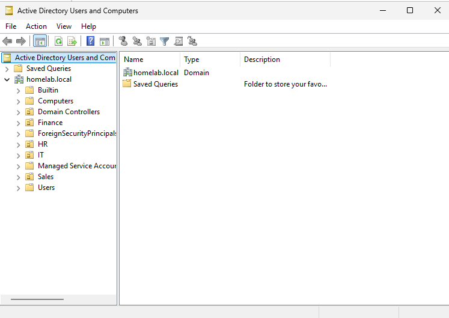
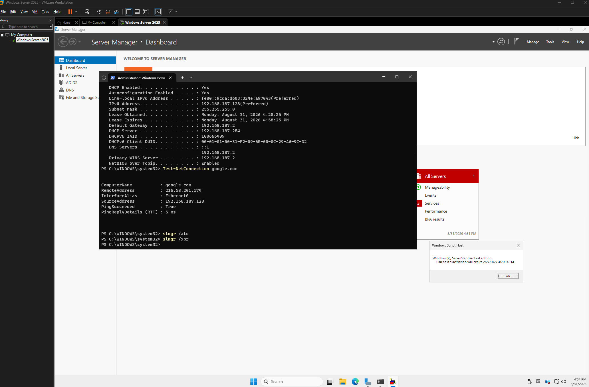

# Phase 03 — OU Design and License Activation Fix

**Date:** 2026-08-31
**Raw working notes:** [`raw-notes/AD DS Documentation.docx`](../raw-notes/AD%20DS%20Documentation.docx)

---

## Purpose

Create the first structure inside the domain: one Organizational Unit (OU) per department. The OUs are where users, groups and later Group Policy will be placed.

While doing this, the server started shutting itself down. Most of this phase ended up being about finding out why and fixing it.

---

## Build

- Four OUs under `homelab.local`: **Sales**, **HR**, **IT** and **Finance**
- "Protect from accidental deletion" left enabled on all four

---

## Configuration

**Creating the OUs** was done in Active Directory Users and Computers (ADUC). Each OU was created with "Protect from accidental deletion" checked.

**How to delete a protected OU** (learned during this phase, not needed yet):

1. In ADUC, open **View** and enable **Advanced Features**
2. Right click the OU, for example `Sales`, then **Properties** and the **Object** tab
3. Uncheck **Protect object from accidental deletion**
4. The OU can now be deleted

I left the box checked on all four OUs, so I cannot remove them by mistake.



---

## Challenges & Troubleshooting

### Problem 1 — The server shut itself down

**What happened.** While creating the OUs and reading about them online on learn.microsoft.com, the VM turned itself off. I assumed it was an update of sorts that must have triggered the shut down. Started up the VM again and carried on with learning and creating OUs. After some time had passed and I moved on to looking up how to create users, the VM shut down for a second time. At this point i realised the shut down was not caused by an update, so I started troubleshooting.

**Finding the cause.** I checked Event Viewer for shutdown and restart events and found **Event ID 1074**, matching the time of the shutdown:

> The process C:\WINDOWS\system32\wlms\wlms.exe (DC01) has initiated the shutdown of computer DC01 on behalf of user NT AUTHORITY\SYSTEM for the following reason: Other (Planned) Reason Code: 0x80000000 Shutdown Type: shutdown

As far as I could find out, this means the Windows evaluation license has not been activated. I checked the license state with:

```powershell
slmgr /dlv
```

This opens a window with license details. In the license details pane I was not able to see a "Time remaining" line, instead the license was in **notification mode** with this reason:

> Notification Reason: 0xC004F009 (grace time expired)

**Root cause.** When I created the VM I put it on an isolated network from the start which means that the server never had internet access, so it was never activated. As I understand it: an unactivated evaluation server shuts itself down after about 60 minutes of runtime, as a reminder to activate it.

So it was the network design from Phase 01 that caused this: the isolation I chose on purpose also blocked activation.

### Problem 2 — Getting the server online for activation

The server needed to get internet access once, just to activate the license. Here is the fix, step by step:

1. Shut down the VM.
2. In VM settings, tried to change the network adapter to NAT. This did not work yet, because no NAT network existed.
3. Inside the guest, changed the IPv4 settings from the static addresses to automatic IP and DNS. This did not fix it. A restart did not either. There was still no internet.
4. Shut down the VM again and opened **VMware, Edit, Virtual Network Editor**. The only network there was host only.
5. Clicked **Change Settings**, added a new network and set it to **NAT**. In my case it became `VMnet01`.
6. In **VM, Settings, Network Adapter**, selected the new NAT network.
7. Started the guest and logged in. Verified the connection:
   ```powershell
   ipconfig /all
   Test-NetConnection google.com
   ```
8. Forced activation online:
   ```powershell
   slmgr /ato
   ```
9. Verified that the activation worked:
   ```powershell
   slmgr /xpr
   ```

After this the evaluation period was active, with about 180 days remaining.



### Problem 3 — Putting the network back

1. Shut down the guest and set the network adapter back to the host only network (**VM, Settings, Network Adapter**).
2. Started the guest and re entered the static IP settings from Phase 02 (IPv4 properties).
3. Checked that the domain was still healthy:
   ```powershell
   Get-ADDomain
   ```

### Problem 4 — A stale DNS record

Since I had changed network and DNS settings, I checked that DC01 could still resolve its own domain:

```powershell
Resolve-DnsName homelab.local
```

It returned **two** A-records for `homelab.local`. One was the correct address, `192.168.50.10`. The other was `192.168.187.128`, left over from the earlier network changes.

I removed it manually in the DNS console:

1. **Server Manager, Tools, DNS**
2. **DC01, Forward Lookup Zones, homelab.local**
3. Find the record named *(same as parent folder)* with data `192.168.187.128`
4. Right click and **Delete**

Then I ran `Resolve-DnsName homelab.local` again, now only `192.168.50.10` was left.

---

## Lessons Learned

- **An isolated lab network blocks activation.** An evaluation server that is never activated will shut itself down. Plan for activation right after installing, before building on the server.
- **Check Event Viewer first for unexplained shutdowns.** Event ID 1074 named the process and the reason for the shutdown. I had guessed "an update", which was wrong, and time could have been saved by checking the Event Viewer directly.
- **Network changes can leave old DNS records behind.** After changing networks on a domain controller, check `Resolve-DnsName` for the domain and clean up anything that should not be there.
- **"Protect from accidental deletion" is useful.** I now know how to turn it off if I ever need to.

---

## Result

Four department OUs in place (Sales, HR, IT, Finance). The server is activated with about 180 days of evaluation time left. The VM is back on the isolated `VMnet2` network with its static IP. DNS has a single A record for `homelab.local`, and `Get-ADDomain` confirms the domain is healthy.

**Next phase:** [Users, Groups and PowerShell Scripting →](./04-users-and-groups.md)
