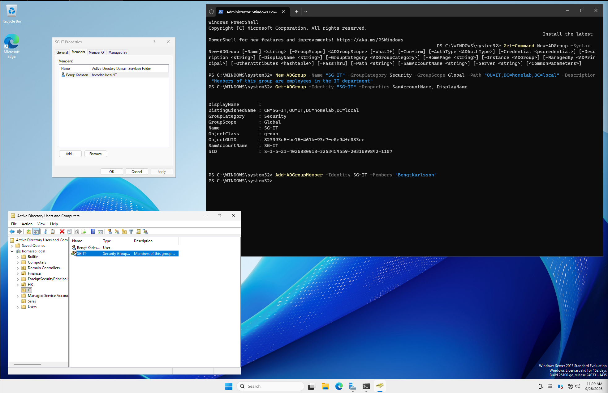
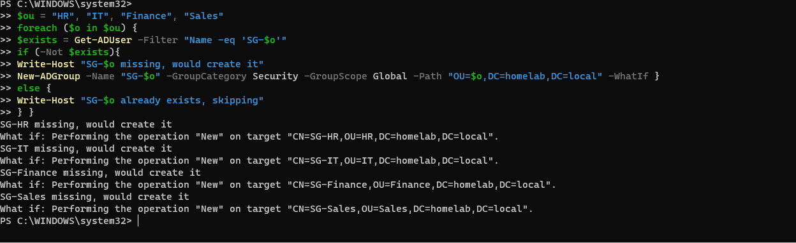
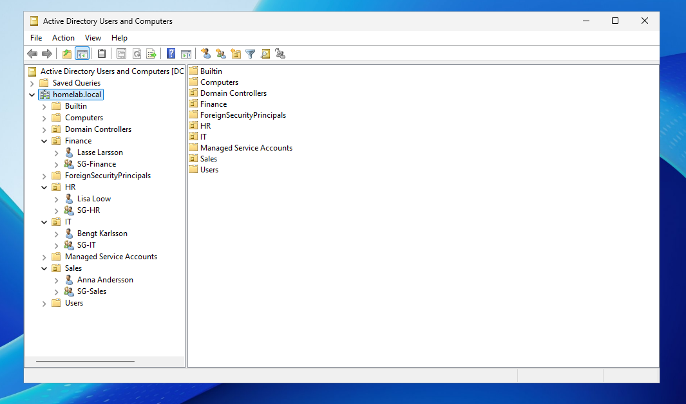

# Phase 04 — Users, Groups and PowerShell Scripting

**Dates:** 2026-09-07 to 2026-09-28
**Status:** In progress. Users and groups are in place. A script for creating users is still to do.
**Raw working notes:** [`raw-notes/AD_DS_Documentation.docx`](../raw-notes/AD_DS_Documentation.docx)

---

## Purpose

Put people and groups into the OUs from Phase 03: one test user and one security group per department. Start with the GUI to learn what the objects look like, then move to PowerShell to learn how to create them with commands and scripts.

---

## Build

All the names used are fictional.

| OU | User | Security group |
|---|---|---|
| Sales | Anna Andersson | `SG-Sales` |
| IT | Bengt Karlsson | `SG-IT` |
| HR | Lisa Loow | `SG-HR` |
| Finance | Lasse Larsson | `SG-Finance` |

Each user is a member of the security group for their department and each group sits inside its own department OU.

**Naming convention for groups:** `SG-[department]`. It makes the groups easy to spot and sort.

---

## Configuration

### Through the GUI 

- Created the user Anna Andersson in the Sales OU. Set "User must change password at next logon", as best practice.
- Created the security group `SG-Sales` inside the Sales OU, so everything for a department stays together.
- Added Anna to `SG-Sales`: **SG-Sales, Properties, Members, Add**.

### Through PowerShell 

**Finding the parameters for `New-ADUser`.** `Get-Help New-ADUser -Examples` did not work, see Problem 1. Instead I used:

```powershell
Get-Command New-ADUser -Syntax
```

This lists every parameter the command accepts. I recognized several of them from the GUI.

**Creating a user** (the command that worked, for Bengt Karlsson in IT):

```powershell
New-ADUser -Name "Bengt Karlsson" -Path "OU=IT,DC=homelab,DC=local" -GivenName "Bengt" -Surname "Karlsson" -SamAccountName "BengtKarlsson" -AccountPassword (ConvertTo-SecureString "<placeholder-password>" -AsPlainText -Force) -ChangePasswordAtLogon $True -DisplayName "Bengt Karlsson" -Enabled $True
```

- `-Path` is the OU the user is created in.
- `-AccountPassword` needs a secure string, so the plain text password is converted first.
- `-ChangePasswordAtLogon $True` forces a new password at first logon.
- `-Enabled $True` creates the account enabled.

I created the users in HR and Finance the same way, with two differences: I set `-UserPrincipalName` directly at creation, and each user got the `-Path` of their own OU.

**Creating a security group** (`SG-IT`, the other groups only differ in `-Name` and `-Path`):

```powershell
New-ADGroup -Name "SG-IT" -GroupCategory Security -GroupScope Global -Path "OU=IT,DC=homelab,DC=local" -Description "Members of this group are employees in the IT department"
```

I did not set `-SamAccountName` or `-DisplayName`. I understood that `-SamAccountName` defaults to the same value as `-Name`, and the group name already felt self explanatory. I made sure this was the case by checking how the groups looked with:

```powershell
Get-ADGroup -Identity "SG-IT" -Properties SamAccountName, DisplayName
```

**Adding a user to a group:**

```powershell
Add-ADGroupMember -Identity SG-IT -Members "BengtKarlsson"
```



---

## Challenges & Troubleshooting

### Problem 1 — Get-Help had no help files

`Get-Help New-ADUser -Examples` reported that it could not find the help files. Windows does not ship with them by default. They have to be downloaded after installation, which needs internet access. The VM was back on the isolated network, and I did not want to switch it to NAT again just for this.

**Workaround:** `Get-Command New-ADUser -Syntax` for the parameter list, plus web searches for examples.

### Problem 2 — A misspelled parameter

My first `New-ADUser` command contained `-UserPrinicalName` instead of `-UserPrincipalName`. It failed with an error. I did not notice the typo at first, so I removed the parameter completely and tried again.

### Problem 3 — The wrong `-Path` format

The second attempt failed on `-Path`. I had written the path as:

```
-Path "OU=IT,DC=homelab.local"
```

Paths in Active Directory are distinguished names. The domain name has to be split into its parts, one `DC=` for each part:

```
-Path "OU=IT,DC=homelab,DC=local"
```

This reads as: the OU `IT`, inside the domain component `homelab`, inside `local`. With that fix the command worked.

### Problem 4 — A user without a UserPrincipalName

Because I had removed `-UserPrincipalName` to get past the typo error, Bengt Karlsson was created without one. I fixed it afterwards:

```powershell
Set-ADUser -Identity "BengtKarlsson" -UserPrincipalName "bengt.karlsson@homelab.local"
```

For the later users I set `-UserPrincipalName` at creation.

### Problem 5 — Testing a script without changing anything

After reading the Active Directory PowerShell documentation I learned about `-WhatIf`. It shows what a command would do without doing it:

```powershell
New-ADGroup -Name "SG-HR" -GroupCategory Security -GroupScope Global -Path "OU=HR,DC=homelab,DC=local" -Description "Members of this group are employees in the Human Resources department" -WhatIf
```

```
What if: Performing the operation "New" on target "CN=SG-HR,OU=HR,DC=homelab,DC=local".
```

Since the only thing that differs between the group commands is the department name, I tried a `foreach` loop. All groups already existed, so I added `-WhatIf` to see what it would do without creating anything:

```powershell
$ou = "HR", "IT", "Finance", "Sales"
foreach ($o in $ou) {
New-ADGroup -Name "SG-$o" -GroupCategory Security -GroupScope Global -Path "OU=$o,DC=homelab,DC=local" -WhatIf }
```

I wanted the script to also work for future departments. It should check whether a group exists, skip it if so, and create it if not. This took longer than I initially expected, since I did not fully understand how to create the check in PowerShell. After some research of PowerShell commands and adapting similar examples, I ended up with this:

```powershell
$ou = "HR", "IT", "Finance", "Sales"
foreach ($o in $ou) {
$exists = Get-ADGroup -Filter "Name -eq 'SG-$o'"
if (-not $exists) {
Write-Host "SG-$o missing, creating it now"
New-ADGroup -Name "SG-$o" -GroupCategory Security -GroupScope Global -Path "OU=$o,DC=homelab,DC=local" -WhatIf
} else {
Write-Host "SG-$o already exists, skipping creation"
}}
```

I wrote this after all four groups were already created as a means to learn scripting, so the `-WhatIf` stays in the script. It only checks that the code runs without errors and nothing is created. In other words, the "create" branch has only been simulated. The script is saved in [`scripts/New-DepartmentGroups.ps1`](../scripts/New-DepartmentGroups.ps1).



---

## Lessons Learned

- **AD paths are distinguished names.** Write them from the object up to the root, with one `DC=` for each part of the domain name.
- **Without help files, `Get-Command <name> -Syntax` still lists the parameters.** It works offline.
- **`-WhatIf` lets me test a command on a live domain safely.** It shows the target of the action without touching it. It does not prove the real run will succeed though.
- **Leaving out a parameter to get past an error can leave an incomplete object.** Removing `-UserPrincipalName` got the command through, but the user was missing it until I fixed it with `Set-ADUser`.
- **A naming convention saves time.** `SG-[department]` made the loop easy to write, because only the department name changes.

---

## Result

Four departments, each with one test user and one security group, and every user is a member of their group. A VM snapshot was taken at this point as a rollback point.



**Still to do in this phase:** write a script that creates users, in the same way as the group script.
